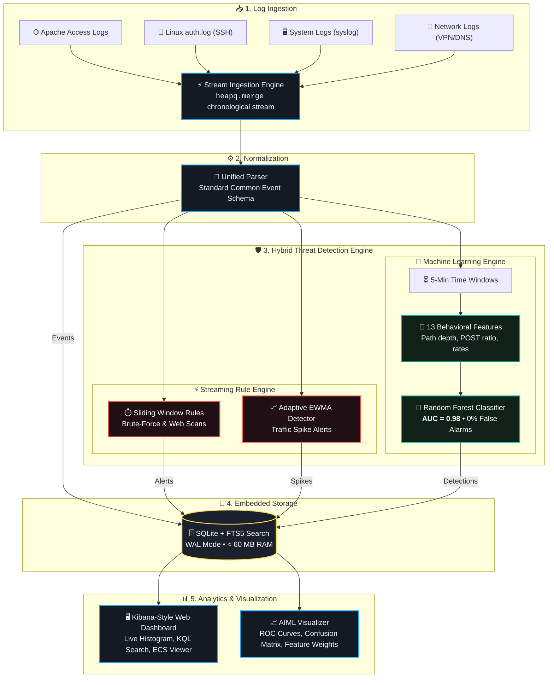

# LightSIEM — Lightweight SIEM & AI/ML Log Analysis Platform

[](https://www.python.org/)
[](https://www.sqlite.org/fts5.html)
[-orange.svg)](https://scikit-learn.org/)
[-brightgreen.svg)](https://www.ait.ac.at/)

LightSIEM is a lightweight, edge-deployable Security Information and Event Management (SIEM) system. It replicates enterprise SIEM pipelines (**Collect $\rightarrow$ Parse $\rightarrow$ Store/Search $\rightarrow$ Detect $\rightarrow$ Visualize**) while maintaining a minimal resource footprint (<60 MB RAM).

Detection combines a **streaming rule engine** (real-time sliding-window rules + adaptive EWMA spike detection) with a **supervised 13-feature Random Forest ML detector** that scores 5-minute traffic windows, achieving an **ROC AUC of 0.98** on authentic enterprise cyber-attack telemetry.

---

## Architecture & Pipeline



### Pipeline Summary Table

| Pipeline Stage | Module / File | Responsibility |
| :--- | :--- | :--- |
| **Collect** | [`siem/ingest.py`](siem/ingest.py) | Merges multi-host log streams chronologically; supports batch ingestion and live `tail -f`. |
| **Parse** | [`siem/parser.py`](siem/parser.py) | Normalizes Apache HTTP access, Linux `auth.log`, `syslog`, OpenVPN, and `dnsmasq` to unified schema. |
| **Store & Search** | [`siem/store.py`](siem/store.py) | Embedded SQLite database with timestamp/IP indexes and FTS5 full-text search. |
| **Streaming Rules** | [`siem/detect.py`](siem/detect.py) | Per-IP sliding window correlation rules (`ssh_bruteforce`, `web_scan`) + adaptive EWMA spike alerting. |
| **Machine Learning** | [`siem/ml.py`](siem/ml.py) | 13-feature Random Forest classifier on 5-minute windows with evasion-aware training. |
| **Enterprise Benchmark** | [`siem/russell.py`](siem/russell.py) | Multi-host log harvester and ground-truth label mapper for the AECID/AIT Russell Mitchell dataset. |
| **AIML Visuals** | [`demo_visualize.py`](demo_visualize.py) | Generates the 4 publication charts (Timeline, Feature Importance, Confusion Matrix, ROC Curve). |
| **Evaluation CLI** | [`evaluate_russell.py`](evaluate_russell.py) | Quantitative benchmark scoring: parse coverage, IP-level attribution, and attack phase detection. |
| **Paper Generator** | [`generate_paper.py`](generate_paper.py) | Automated IEEE 2-column Word document assembler and headless LibreOffice PDF exporter. |
| **Web Dashboard** | [`siem/server.py`](siem/server.py), `static/` | Zero-dependency browser dashboard (live event rates, alert feeds, instant IP search). |

---

## Repository Structure

```text
lightsiem/                            # Core application source directory
    ├── assets/                           # High-res generated figures for IEEE paper
    ├── siem/                             # SIEM Python package
    │   ├── detect.py                     # Streaming sliding-window rules & EWMA
    │   ├── gen_logs.py                   # Controlled synthetic attack log generator
    │   ├── ingest.py                     # Multi-stream chronological log reader
    │   ├── ml.py                         # 13-feature Random Forest ML engine
    │   ├── parser.py                     # Multi-protocol log normalizer
    │   ├── russell.py                    # Russell Mitchell dataset harvester
    │   ├── server.py                     # Web server & REST API
    │   └── store.py                      # SQLite & FTS5 storage backend
    ├── static/                           # Web dashboard HTML/JS frontend
    ├── demo_visualize.py                 # Interactive AIML visualization script
    ├── evaluate_russell.py               # Ground-truth evaluation script
    ├── generate_paper.py                 # IEEE docx/pdf paper generation tool
    ├── lightsiem.py                      # Unified CLI entry point
    ├── results_russell.json              # Evaluated benchmark metrics output
    └── rm_local.db                       # Pre-ingested SQLite database (153k events)
```

---

## Quick Start & Usage

### 1. Visual AIML Demo (4 Key Charts)
Displays the 4 evaluation charts using the multi-host real-world dataset:

```bash
cd lightsiem

# Instant run from cached database (153,174 events, ~2 seconds):
python demo_visualize.py --skip-ingest

# Or run instant synthetic demo (~5 seconds, no dataset needed):
python demo_visualize.py --demo
```

**Charts generated in `assets/`:**
- **Chart 1 — Timeline**: Event volume over time with 225 detected attack alerts overlaid.
- **Chart 2 — Feature Importance**: Relative weight of the 13 behavioral ML features.
- **Chart 3 — Confusion Matrix**: Classification of 2,485 five-minute windows ($1,675\text{ TN}, 0\text{ FP}, 370\text{ TP}$).
- **Chart 4 — ROC Curve**: Random Forest ROC curve showing **AUC = 0.98**.

---

### 2. Interactive Web Dashboard
Launch the zero-dependency browser dashboard:

```bash
# Serve pre-ingested multi-host database on http://127.0.0.1:8080:
python lightsiem.py serve --db rm_local.db --port 8080

# Or run self-contained instant demo mode:
python lightsiem.py demo
```

**Dashboard Features:**
- Live events-per-minute traffic timeline.
- Real-time alert feed with severity tags (`traffic_spike`, `web_scan`).
- Top talker IP breakdown with reverse lookup.
- Full-text and IP address search powered by SQLite FTS5.

---

### 3. Real-World Benchmark Evaluation
Run the automated scoring script against the AECID Russell Mitchell ground-truth labels:

```bash
python evaluate_russell.py /path/to/russellmitchell --db rm_local.db --out results_russell.json
```

---

### 4. Regenerate IEEE Paper & PDF
To rebuild the IEEE 2-column paper with updated chart figures and performance metrics:

```bash
python generate_paper.py
```
Outputs:
- `../IEEE_Paper_Full_Draft_LightSIEM.docx`
- `../IEEE_Paper_Full_Draft_LightSIEM.pdf`

---

## Machine Learning Feature Engineering (13 Features)

Features are computed over 5-minute per-IP windows (`siem/ml.py`):

| # | Feature Name | Description & Security Purpose |
| :-: | :--- | :--- |
| 1 | `distinct_path_depth` | Average URL path depth (scanners probe deeply nested endpoints like `/wp-content/plugins/...`). |
| 2 | `post_ratio` | Ratio of HTTP POST requests (webshell uploads, exploit delivery, credential brute-forcing). |
| 3 | `request_rate` | HTTP requests per second in window (quantifies automated scanner throughput). |
| 4 | `distinct_url_ratio` | Unique URLs probed relative to total requests (broad reconnaissance identifier). |
| 5 | `webshell_indicator` | Regex pattern matches for execution parameters (`shell`, `cmd`, `upload`, `exec`, `eval`). |
| 6 | `http_requests` | Total HTTP requests in the 5-minute window. |
| 7 | `log_events` | Total log volume in window ($\log(1+n)$ transformed). |
| 8 | `err4xx_ratio` | Proportion of 4xx client errors relative to total HTTP requests. |
| 9 | `n404` | Raw count of HTTP 404 (Not Found) responses. |
| 10 | `consecutive_404_ratio` | Fraction of 404 responses immediately following another 404 (sequential brute-forcing). |
| 11 | `n5xx` | Raw count of HTTP 5xx server errors (indicates crash attempts or malformed exploit payloads). |
| 12 | `ssh_fail` | Count of failed SSH authentication attempts. |
| 13 | `distinct_users` | Number of distinct usernames targeted in authentication attempts. |

---

## Real-World Benchmark Results

Evaluated on the **AECID Russell Mitchell Cyber Attack Dataset** across 4 enterprise hosts (`intranet_server`, `webserver`, `mail`, `internal_share`):

- **Total Ingested Events:** 153,174 events
- **Streaming Rule Alerts:** 225 real-time alerts (`traffic_spike`, `web_scan`)
- **Attacker IP Attribution:** 
  $$\text{Precision} = 1.00, \quad \text{Recall} = 1.00, \quad F_1 = 1.00 \quad (\text{Attacker: } 172.19.131.174)$$
- **Random Forest ROC AUC:** **0.98** (0.9772)
- **Window Confusion Matrix (2,485 windows):**
  - **True Negatives:** 1,675 windows
  - **False Positives:** **0 windows** (0.0% false alarm rate)
  - **True Positives:** 370 windows
  - **False Negatives:** 440 windows *(quiescent pauses between attack commands)*
- **Web Attack Parse Coverage:** 
  - Direct HTTP Attacks: **99.5%** (7,687 / 7,723)
  - `dirb` Directory Scans: **99.3%** (4,462 / 4,493)
  - `wpscan` Vulnerability Scans: **99.3%** (3,186 / 3,207)
  - Webshell Uploads: **100%** (3 / 3)
  - Sudo Privilege Escalation: **100%** (3 / 3)

---

## Requirements & Installation

- **Python 3.9+**
- Core ingestion, parsing, database, rules, and web server require **standard library only**.
- AI/ML and visualization dependencies:
  ```bash
  pip install scikit-learn numpy matplotlib seaborn
  ```
