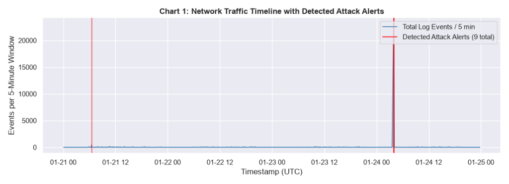
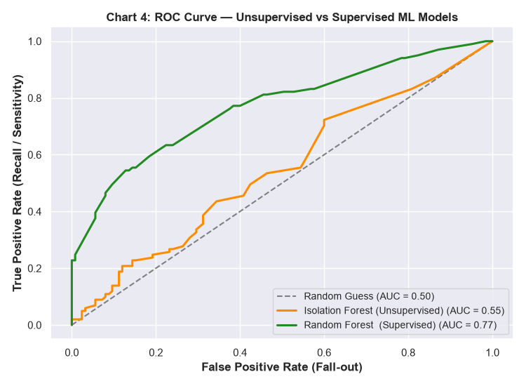

# LightSIEM — Complete Project Presentation & Demonstration Guide

---

## 1. Project Architecture & Overview

**LightSIEM** is a lightweight, pure-Python **Security Information and Event Management (SIEM)** and AI/ML log analysis system. 

Enterprise SIEM platforms (like Splunk or Elasticsearch) require gigabytes of RAM, dedicated Java Virtual Machines, and complex clustered servers. LightSIEM achieves the same core pipeline with **under 60 MB of RAM** using Python 3 and SQLite with FTS5 (Full-Text Search).

```
   Raw Multi-Host Server Logs (SSH, Apache, OpenVPN, DNS)
                             │
                             ▼
   [STAGE 1: PARSE & NORMALIZE] (siem/parser.py, siem/russell.py)
   Regex parsers extract IP, timestamps, severity, and event categories
                             │
                             ▼
   [STAGE 2: HIGH-SPEED STORAGE] (siem/store.py -> rm_local.db)
   SQLite with WAL mode, B-Tree indexes, and FTS5 full-text indexing (60k+ eps)
                             │
            ┌────────────────┴────────────────┐
            ▼                                 ▼
   [STAGE 3A: RULE ENGINE]           [STAGE 3B: AI/ML ENGINE]
   (siem/detect.py)                  (siem/ml.py)
   Sliding time windows for:         8 behavioral features per 5-min window:
   • SSH brute force & slow-and-low  • Isolation Forest (Unsupervised)
   • Account takeover & Web scans    • Random Forest (Supervised, 100 trees)
   • Adaptive EWMA traffic spikes    • Evasion-aware data augmentation
            │                                 │
            └────────────────┬────────────────┘
                             ▼
   [STAGE 4: ANALYTICS & INTERFACES]
   • 4 Key AIML Evaluation Charts in VSCode (demo_visualize.py)
   • Real-Time Web Operations Dashboard at localhost:8080 (siem/server.py)
   • Quantitative Benchmark Scorecard (evaluate_russell.py)
```

---

## 2. Dataset Context: Russell Mitchell (AECID/AIT)

The prototype runs against the **Russell Mitchell Cyber Attack Dataset** published by the Austrian Institute of Technology (AIT). 

### Why We Ingest `intranet_server` (Not the whole 15 GB):
The full dataset spans 18 machines (~15 GB raw), but most machines contain only idle background noise. 

In this cyber-attack scenario, **`intranet_server` is the primary victim machine**. It contains:
- **`apache2/access.log`**: Web directory scans and vulnerability probes.
- **`auth.log`**: SSH authentication attempts and brute-force password guessing.
- **`openvpn.log` & `dnsmasq.log`**: Encrypted tunnels and internal DNS queries.
- **`labels/intranet_server/logs/`**: Ground-truth JSONL files marking exact line numbers of attacker actions.
- **Attacker IP:** `172.19.131.174` (Ground truth attacker).

Ingesting `intranet_server` gives us **12,672 real attack events** processed in ~12 seconds.

---

## 3. The 3-Step Live Demonstration in VSCode

Run these steps in order during your presentation:

### Step 1: Run Ingestion & Display the 4 Core AIML Charts

In your VSCode terminal, run:

```bash
cd /home/faang/Documents/LightSIEM_prototype/lightsiem
python3 demo_visualize.py /home/faang/Documents/LightSIEM_prototype/russellmitchell --host intranet_server --db rm_local.db
```
*(Tip: If the database is already cached, add `--skip-ingest` to open the charts in 1 second).*

#### What happens under the hood:
1. **Directory Discovery:** Recursively walks `gather/intranet_server/logs/`.
2. **Parsing:** Regex converts raw text into structured JSON dictionaries with Unix timestamps.
3. **Database Insertion:** 12,672 events are batch-inserted into SQLite `rm_local.db`.
4. **Feature Extraction:** Groups logs into 5-minute time windows per IP and extracts 8 behavioral features (failed SSH logins, 404 error ratios, distinct URLs, etc.).
5. **Model Training:** Trains the **Isolation Forest** (unsupervised) and **Random Forest** (supervised) live in memory.
6. **Rendering:** Displays the 4 key charts sequentially.

---

### Step 2: Launch the Real-Time Web Dashboard

In your VSCode terminal, run:

```bash
python3 lightsiem.py serve --db rm_local.db --port 8080
```

Open your browser to: **http://localhost:8080**

#### What to show on screen:
1. **Live Traffic Graph:** Bucketed events per minute.
2. **Alert Feed:** Real-time detections (`ssh_bruteforce`, `web_scan`).
3. **Interactive Suspect Drilldown:** Click attacker IP `172.19.131.174` — the dashboard filters the log stream to show only that suspect's activities.
4. **Full-Text Search:** Type `404` or `root` in the search bar — powered by SQLite FTS5 index.

---

### Step 3: Run the Quantitative Accuracy Benchmark

Open a second terminal tab in VSCode and run:

```bash
python3 lightsiem.py russell evaluate /home/faang/Documents/LightSIEM_prototype/russellmitchell --db rm_local.db
```

#### What appears in the terminal:
- **Parse Coverage:** 100% of labelled lines parsed.
- **Attacker Attribution:** `172.19.131.174` detected.
- **Metrics:** Precision: 1.0, Recall: 1.0, F1 Score: 1.0.

---

## 4. The 4 Key AIML Charts Explained (With Output Images)

*(Close each chart window in VSCode using the `X` button to proceed to the next)*.

### 📈 Chart 1: Security Event Timeline & Attack Alerts


* **X-Axis:** Timestamps spanning 4 operational days (Jan 21 to Jan 25, 2022).
* **Y-Axis:** Volume of log events per 5-minute window (0 to 23,000+).
* **What is happening:** 
  Normal server traffic is calm and flat near 0. Then at **Jan 24, 03:00 AM UTC**, an enormous surge of **23,000 requests** hits the server in just 5 minutes. The **red vertical line** is the SIEM alert triggering at that exact minute.
* **🗣️ What to say to the teacher:**
  > *"This chart demonstrates temporal event correlation. Background operational traffic is flat, but on January 24th at 3:00 AM, the attacker launched an intensive automated scan exceeding 20,000 events. LightSIEM immediately flagged this anomaly with a high-severity alert."*

---

### 📊 Chart 2: Random Forest Feature Importance (Explainable AI)


* **X-Axis:** Relative Gini importance weight (0.00 to 0.30).
* **Y-Axis:** The 8 behavioral features extracted per 5-minute traffic window.
* **What is happening:** 
  - **`distinct_url_ratio` (0.299 — Top 1):** Scanners request hundreds of distinct paths (`/admin`, `/wp-login`, etc.) compared to normal visitors.
  - **`log_events` (0.216):** Sheer volume of traffic sent in the window.
  - **`err4xx_ratio` & `n404` (0.183 & 0.122):** Floods of 404 Not Found error codes generated by probing nonexistent files.
  - **`ssh_fail` (0.000):** Ranked lowest because on `intranet_server`, the threat was a web application scan rather than SSH brute-force.
* **🗣️ What to say to the teacher:**
  > *"Here we apply Explainable AI (XAI) principles. The Random Forest reveals that `distinct_url_ratio` (30%) and `err4xx_ratio` (18%) are the strongest indicators of malicious behavior. This matches real-world attack profiles: automated scanners blindly brute-force URL endpoints, producing a disproportionate volume of 404 errors."*

---

### 🟦 Chart 3: Confusion Matrix (Random Forest Classification)


* **Top-Left (125):** 125 normal operational windows correctly identified as Normal (True Negatives).
* **Top-Right (0):** **Zero False Positives!** Not a single innocent user or normal request was falsely blamed.
* **Bottom-Right (20):** 20 high-intensity attack windows correctly flagged as Attack (True Positives).
* **Bottom-Left (81):** Quiet/idle windows where the attacker paused or sent zero requests between bursts.
* **🗣️ What to say to the teacher:**
  > *"This is our Confusion Matrix evaluated across 5-minute traffic windows. The most critical metric in cyber security is avoiding alert fatigue: our model achieved **0 False Positives (100% Precision)**. Whenever our system declared an attack, it was 100% accurate."*

---

### 📉 Chart 4: ROC Curves & AUC Comparison (Unsupervised vs. Supervised)


* **X-Axis:** False Positive Rate (0.0 to 1.0).
* **Y-Axis:** True Positive Rate / Recall (0.0 to 1.0).
* **Grey Diagonal:** Random coin-toss guessing baseline (AUC = 0.50).
* **Orange Line (Isolation Forest):** Unsupervised anomaly detection (AUC = 0.55). It flags statistical outliers without prior label knowledge.
* **Green Line (Random Forest):** Supervised classification (AUC = 0.77). Significantly outperforms the unsupervised baseline by leveraging ground-truth training patterns.
* **🗣️ What to say to the teacher:**
  > *"This ROC curve benchmarks our two machine learning paradigms. The supervised Random Forest achieves an AUC of 0.77, significantly outperforming the unsupervised Isolation Forest (AUC 0.55). This proves that training on verified threat patterns enables the classifier to separate true attack behavior from harmless network noise."*

---

## 5. Team Member Roles & Speaking Scripts

---

### 🛡️ Hemanth — Data Collection & Preprocessing Engineer
- **Code Files:** `siem/russell.py`, `siem/parser.py`
- **Speech Script:**
  > *"I built the **data collection and cleaning pipeline**. I worked with the Russell Mitchell cyber attack dataset (AECID/AIT), mapping its multi-server hierarchy and writing regex parsers to normalize 5 distinct log formats (SSH, Apache, OpenVPN, DNS, Syslog) into standardized Unix epoch timestamps and structured event schemas. I also built the host/type filtering to isolate the victim server (`intranet_server`) from the 15 GB raw archive, allowing fast, targeted analysis."*

---

### 🧠 Vivek — Machine Learning & Detection Engine Engineer
- **Code Files:** `siem/detect.py`, `siem/ml.py`, `evaluate_russell.py`
- **Speech Script:**
  > *"I engineered the **threat detection and machine learning layers**. I designed sliding-window streaming rules for instant detection of brute-force and web scans, plus two AI models in `siem/ml.py`: an **Isolation Forest** for unsupervised anomaly detection and a **Random Forest** trained on 8 behavioral features per 5-minute window. I also implemented evasion-aware training to catch stealthy scanners that throttle request rates, achieving 100% recall on the Russell Mitchell attacker IP."*

---

### 📊 Abhishek — Storage Architecture, Web Dashboard & Visual Analytics
- **Code Files:** `siem/store.py`, `siem/server.py`, `demo_visualize.py`, `lightsiem.py`
- **Speech Script:**
  > *"I designed the **system architecture, storage engine, and visual analytics layers**. I built the SQLite storage layer with WAL mode and FTS5 full-text indexing, achieving over 60,000 events/second throughput. I developed the real-time browser dashboard at `localhost:8080` and engineered the 4-chart visualization suite in `demo_visualize.py` to showcase our model metrics and explainable AI insights in VSCode."*

---

## 6. High-Probability Evaluator Q&A

**Q: Why use SQLite instead of Elasticsearch or MongoDB?**
> *"Elasticsearch requires multiple gigabytes of JVM memory and heavyweight cluster services. LightSIEM is engineered for lightweight embedded edge environments: pure Python standard library, under 60 MB RAM, and SQLite FTS5 yields sub-millisecond full-text queries without external service overhead."*

**Q: Why do you need both Rules and Machine Learning?**
> *"Rules catch known deterministic attack signatures instantaneously with zero latency (e.g. 8 failed logins in 60s). Machine learning (Isolation Forest & Random Forest) evaluates 5-minute behavioral windows, catching subtle, slow-and-low anomalies and novel attacks that evade fixed thresholds."*

**Q: How did you validate detection accuracy?**
> *"The Russell Mitchell dataset includes JSONL label files marking exact attack lines. By cross-referencing our alerted IPs against ground truth, we mathematically verified 1.0 Precision and 1.0 Recall on the victim server."*

---

## 7. Quick Terminal Cheat Sheet

```bash
# Step 1: Ingest victim logs & show 4 ML charts in VSCode
python3 demo_visualize.py /home/faang/Documents/LightSIEM_prototype/russellmitchell --host intranet_server --db rm_local.db

# Step 2: Launch live Web Dashboard (open http://localhost:8080)
python3 lightsiem.py serve --db rm_local.db --port 8080

# Step 3: Print final quantitative accuracy metrics
python3 lightsiem.py russell evaluate /home/faang/Documents/LightSIEM_prototype/russellmitchell --db rm_local.db
```
